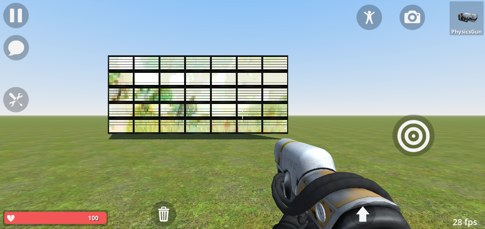
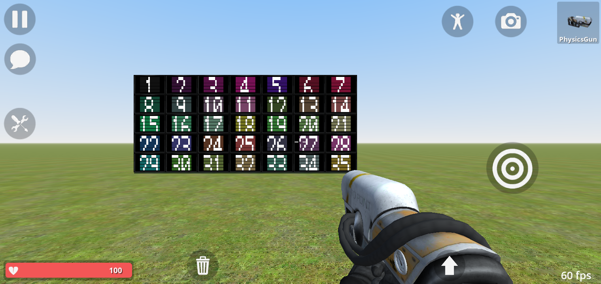

# Hypper TV

An unofficial Android app that creates a room in **Hypper** and spawns a wall of
in-game **Monitor** props, then streams a video (YouTube link or direct mp4) onto
that wall by re-rendering the picture as rich text on every monitor.

The project is a native Rust core (Photon protocol client) exposed to a minimal
Java/Android UI through JNI. The original Python prototypes that this app was
built from are included in [`PhotonPy/`](PhotonPy).

<p>
  
  
</p>

## Features

- Creates a **password-protected room** (Free / Private / Adventure) with
  MaxProps = 1000, MaxVehicles = 40 and a custom (possibly rich-text) room name.
- Spawns a `cols x rows` wall of `Monitor` props in front of the player and keeps
  them in sync over Photon (event 202 for instantiate, event 206 for sync).
- **Video source:** YouTube links (`youtu.be`, `watch?v=`, `/shorts/`, `/embed/`,
  `/live/`) are resolved with the embedded `youtubei/v1/player` Android client and
  downloaded in explicit `Range` chunks; direct http(s) mp4 links are supported
  too. Frames are extracted with `MediaMetadataRetriever`, converted to RGB24 and
  pushed into Rust, which slices the frame into one text block per monitor.
- **Calibration mode** (per-column hue, per-row brightness, white marker) to
  verify tile order, mirroring, and clipping from a single screenshot.
- All settings are **saved between launches** (room, password, video URL, fps,
  wall size, wait time, wall centre, calibration flag).
- Configurable from the UI or from `adb shell am start ... --es ...`.

## Repository layout

```
hypper-rust/     Photon protocol 18 client, room creation, events, ACK/retransmit
hypper-android/  cdylib JNI wrapper (room + wall + frame loop) and the Android app
  android/       Java UI, YouTube resolver, MediaMetadataRetriever frame pump
PhotonPy/        Original Python prototypes (reference implementation)
docs/            Screenshots
```

## How it works

1. Auth on the Photon master server, create the room, receive the game-server
   address and token, connect to the game server, join the room.
2. Wait for a player and their loading to finish, then spawn `cols*rows`
   monitors 0.3 s apart (a dense burst makes the client drop the tail of the
   instantiate stream).
3. Every frame: extract the video frame, scale it to `cols*cellW x rows*cellH`,
   convert each cell to lines of `<color=#RGB>█</color>` and send one sync event
   per monitor whose text changed.

### Findings baked into the code

- **Monitor text is mirrored and flipped.** The prop is rotated 180° about Y and
  the text is rendered upside down, so both the X axis and the row order are
  pre-flipped when generating each tile.
- **Text grid.** The game does not scale `<size>` linearly; a grid of
  **22x12 at `size=42%`** fills the panel best. The remaining red strips in the
  red-background test (`PhotonPy/monitor_fill_test.py`) are the font's line
  spacing (~10-15% of a row), not our margins; a denser grid makes them
  sub-pixel and they blend with the pixels.
- **Panel background** is a constant black (`#000000`), like in the old Python
  script: uncovered edges and inter-line gaps blend into the black frame.
- **Wall height.** The bottom row is placed at 2.0 m so it does not sink into the
  terrain on slopes. The wall centre can be overridden (`cy`).
- **View ids** for spawned monitors start at `actor*1000 + 800 + i`; lower sub-ids
  collide with the game's own scene objects.
- **Frame rate.** `MediaMetadataRetriever` with `OPTION_CLOSEST_SYNC` only returns
  keyframes (about one every 2 s in the test video), so the picture visibly
  advanced only every couple of seconds. The app now decodes sequentially with
  `MediaCodec` (`VideoPump.java`), paced to real time, and falls back to
  `MediaMetadataRetriever` with `OPTION_CLOSEST` if the codec path fails.

## Building

Requirements: Rust with the `aarch64-linux-android` target, Android NDK (tested
with r26), Android SDK (platform 34), JDK 17, Gradle 8.x.

```bash
# 1) Native library
cd hypper-android
# Adjust linker paths in .cargo/config.toml or add the NDK toolchain to PATH.
cargo build --release --target aarch64-linux-android
cp target/aarch64-linux-android/release/libhypper_android.so \
   android/app/src/main/jniLibs/arm64-v8a/

# 2) APK
cd android
gradle assembleDebug
# -> app/build/outputs/apk/debug/app-debug.apk
```

Install with `adb install -r app-debug.apk` (arm64-v8a only).

## Usage

Fill in the room name, columns, rows, pixels per monitor (`18x10`), text size
(`50%`), fps, max players, password, mode, video URL and wait time, then press
**Старт**. Join the room from the game on another device.

Scripted launch:

```bash
adb shell am start -n com.hypper.tv/.MainActivity \
  --es room '<color=green>HypperTV</color>' --es password 1234 \
  --es cols 7 --es rows 5 --es url https://youtu.be/VIDEO_ID \
  --ez autostart true
```

Add `--ez pattern true` for the calibration wall.

## Python prototypes

`PhotonPy/` contains the original scripts needed to reproduce the video wall
(`hypper_tv.py`, `monitor_test.py`, `ptWorkFreeze.py`, `photon0509.py`) plus
`monitor_fill_test.py` (the red/green pixel-fill diagnostic). They implement
the same protocol and were used to calibrate geometry and text layout. They
need the game's Photon AppId/auth constants (already present) and Python 3.

## Legal

Unofficial fan project, not affiliated with the game's developers. It speaks the
game's public Photon protocol for interoperability and is provided for research
and educational purposes only. Use at your own risk.

## License

MIT — see [LICENSE](LICENSE).